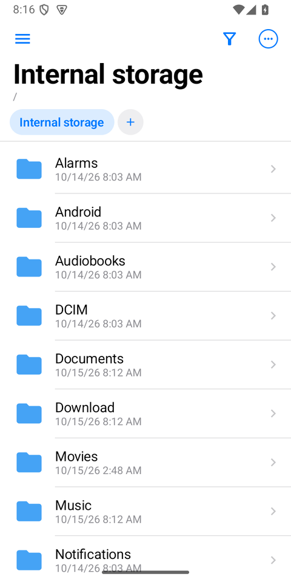
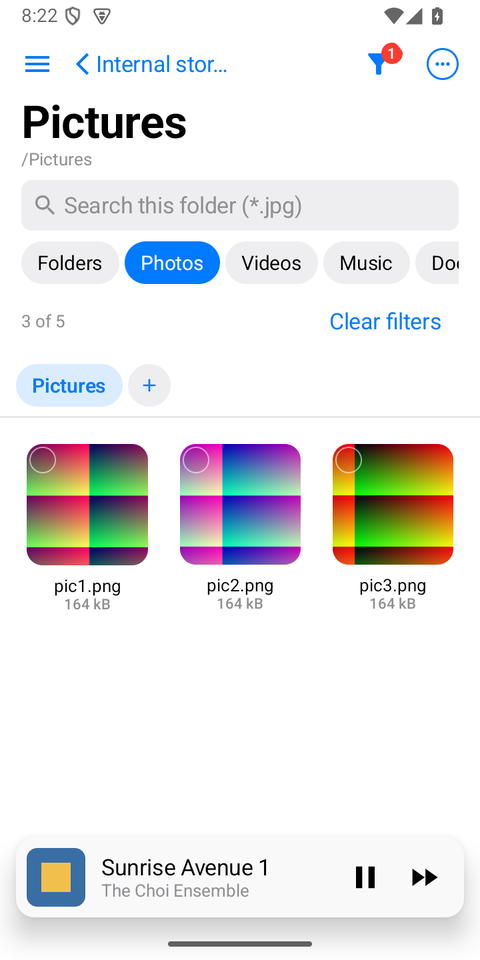
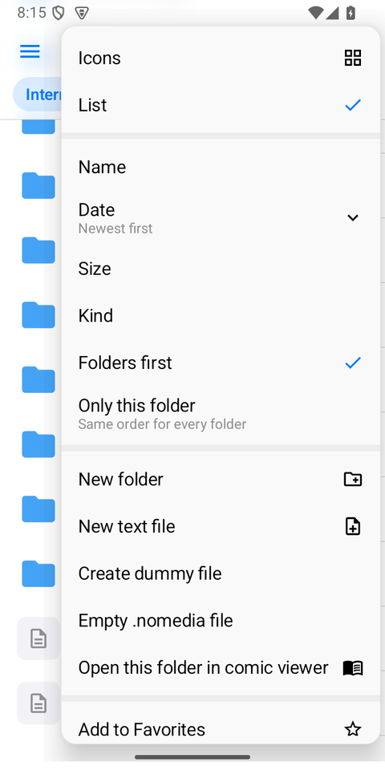
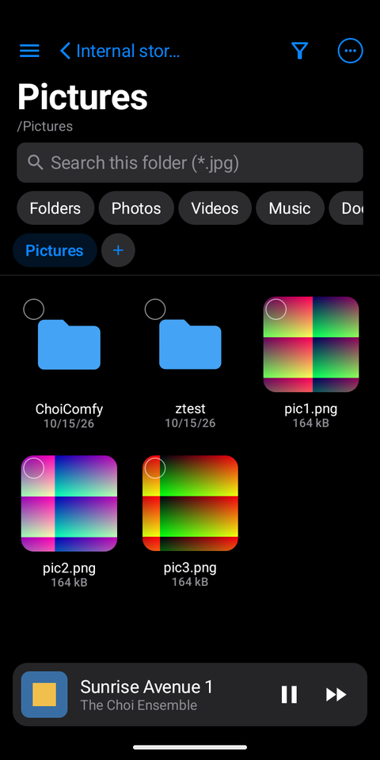
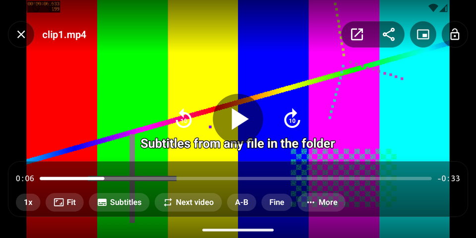
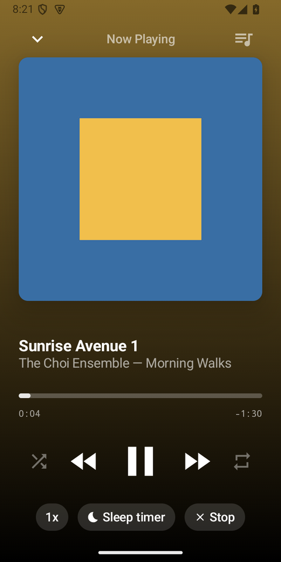
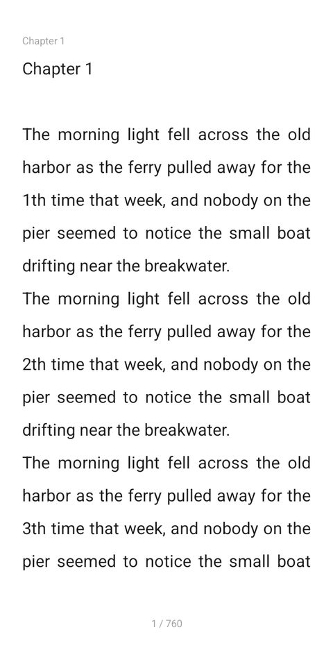

# choifile

**An Android file manager with an iOS look, and the viewers built in.** Tabs, grid and list views, drag-to-select and
sorting and filtering per folder come with a fingerprint lock, protected folders, a hidden vault, file encryption,
network drives, and players for video, music and books, so most files open without leaving the app.

English · [한국어](README.ko.md) · Languages in the app: English, 한국어, 日本語

<p>
  
  
  
  
</p>
<p>
  
  
  
</p>

## Download

Get the APK from [Releases](https://github.com/choidevhi/choifile/releases/latest):

- `choifile-x.y.z-arm64.apk` for almost every phone from the last few years (smaller download)
- `choifile-x.y.z.apk` for every device (arm64, armv7, x86, x86_64)

Requires Android 8.0 (API 26) or later. choifile asks for "All files access" to manage your storage.

## Features

**Browsing**
- iOS-style navigation: a large title that folds into the bar, a back button named after the parent folder,
  slide-in folder transitions, a swipe from the left edge to go back
- Several tabs (swipe sideways to switch), grid or list remembered per folder, scroll position remembered per folder
- Sort by name (natural order: file2 before file10), date, size or kind; folders first or mixed; one order for all
  folders or one of its own for a folder
- Filter the open folder by name (with `*` and `?` wildcards, and Korean initial consonants such as ㅎㄱ), by kind
  (folders, photos, videos, music, documents, archives, APKs), by last-modified date and by size
- Long-press and drag to select a range, favorites in the sidebar

**Files**
- Copy, move, rename, share, compress; a trash with restore, and an undoable operation log
- zip, 7z and tar family archives: create, extract, and browse an archive like a folder; rar read-only
- `.nomedia` toggle, APK install, a dummy-file generator, duplicate finder, storage analysis, search index,
  automation rules

**Security**
- App lock with fingerprint or the device screen lock, protected folders with a grace period
- A hidden vault, AES-256-GCM file encryption (`.cfenc`), overwrite-before-delete

**Network**
- SFTP, SMB, FTP and WebDAV drives, Tailscale device discovery
- A built-in HTTP and FTP server with token sign-in, for reaching the phone from a PC

**Video**
- Gestures: swipe to seek, brightness on the left, volume on the right (boost to 200%), hold for 2x, pinch to zoom,
  double-tap to skip
- Picture modes (fit, crop, stretch, 16:9, 4:3, original), lock, auto rotation, resume where each video was left
- The folder as a playlist with an end action, A-B loop, frame stepping, 0.25x to 3x
- Subtitles from any file in the folder (SRT, ASS, VTT and SAMI), any encoding (UTF-8, CP949 and more), sync in
  0.1 s steps saved per video, size, color and background
- Picture-in-picture, sound only, or stop when you leave the app (asked on first playback)
- Hardware or FFmpeg decoding (H.264, HEVC, VP8/9, MPEG-2, AC3, DTS, FLAC, Opus and more), sleep timer, screenshots

**Music**
- A player that keeps going while you browse or leave the app, with notification and lock screen controls
- Cover art and tags, the folder as the queue, shuffle, repeat, speed, sleep timer, and a mini player above the
  file list

**Books and text**
- An e-reader for `.txt` novels: page turns with a curl, fonts, themes, table of contents, search, bookmarks,
  volume keys to turn pages, reading position kept per book; a tapped `.txt` asks for the text viewer or the
  e-reader, and the answer can be pinned
- Text files of any size open read-only and instantly (only the visible part is read); smaller ones can be edited
  in their own encoding

**Other viewers**
- Photos (swipe between them, pinch zoom), PDF, Markdown, code with syntax highlighting, comics (vertical scroll,
  reading position kept)

## Build

```
$env:JAVA_HOME='C:\Program Files\Android\Android Studio\jbr'
.\gradlew.bat assembleDebug testDebugUnitTest
```

Release signing reads `CHOIDEV_RELEASE_*` from `~/.gradle/gradle.properties`; without them the release build is
unsigned. `-Pchoifile.abi=arm64-v8a` builds an APK with a single ABI.

## License

GPL-3.0. The FFmpeg extension for video codecs (NextLib) is GPL-3.0, so the whole app is published under the same
license. The libraries used are listed in [THIRD_PARTY.md](THIRD_PARTY.md).
